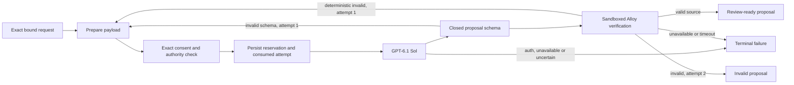

# LangGraph implementation: verified source proposals

This is the first executable component of the
[AI development contract](ai-native-development.md). It uses the installed
LangGraph 1.2.19, an OpenAI `gpt-6.1-sol` adapter, a durable dispatch journal and the
existing sandboxed Java document verifier. It is an isolated library and authored
fixture CLI. The public website remains AI-disabled. The subsequent
[private system integration](ai-system-integration.md) supplies Spring authority,
payload consent and browser draft apply/undo. Typed-slot editing and RAG grants
remain pending.

The [implementation supplement](../spec/ai-langgraph-implementation.json) and
[finite Lean model](../formal/Allow/AiLangGraphImplementation.lean) precede the
implementation. Read the [implementation evidence](../gates/ai-langgraph-v1/report.json)
for actual results and limits, rather than inferring a complete product gate from
the presence of these modules.

On 5 November 2026, all 50 component tests passed, including three real sandboxed
Java integration tests. The offline invalid/repair fixture reached `REVIEW_READY`
in 543 ms. The initial OpenAI test returned HTTP 401. With the user-supplied
replacement credential, the live test reached `REVIEW_READY` on its first attempt
in 3.98 seconds, with actual sandboxed Java verification and a `TEXT_ONLY`
projection. Both dispatch reservations remain in the same private ledger; its
100000 micro-USD ceiling is fully reserved. Neither credential was written to
this project. This single timing is not a production benchmark, and source
validation does not establish that the proposal implements the intended behavior.

## Graph and verification loopback



The graph makes at most two provider calls: initial generation plus one repair.
A failed schema/parse/type/projection check rebuilds the prompt from the original
authorized input and a closed diagnostic code. It does not append raw failed
responses, arbitrary parser text or private paths. The replacement is verified
from scratch. A second failure returns `INVALID_PROPOSAL`.

Every dispatch needs fresh exact consent and a current host-authority check.
Authentication, permission, budget, stale state, refusal, rate limiting, malformed
provider envelopes, timeouts and uncertain dispatches stop without loopback.
An explanation returns `SUGGESTION`; it does not acquire a type or solver verdict.
Valid source retains the verifier's `BLOCK_SUPPORTED` or `TEXT_ONLY` projection.
Neither path applies an edit or saves an accepted document.

## Run the authored fixture without a key

Use the existing built backend and provisioned retrieval environment. From the
repository root, create a fresh private ledger directory outside the checkout:

```bash
allow_ai_demo_dir="$(mktemp -d /tmp/allow-ai-demo.XXXXXX)"
PYTHONPATH=retrieval .tools/retrieval-venv/bin/python -B -m allow_ai.demo \
  --ledger "$allow_ai_demo_dir/dispatch.json"
```

The default provider is a deterministic fixture: it supplies invalid Alloy first,
then a valid correction. The graph and Java validator are real. The CLI prints
only status, attempt count, verification/projection, timing and conservative
accounting metadata. It does not print model/source content or credentials.

The worker requires an unprivileged account without effective bypass capabilities.
It verifies a cgroup-v2 process ceiling of 512 or fewer tasks, or falls back to the
fixed per-UID `RLIMIT_NPROC=512`. A busy shared workstation account can exceed that
per-UID limit. When user systemd supports it, run the fixture inside its own
temporary bounded scope instead:

```bash
systemd-run --user --scope --property=TasksMax=512 \
  /usr/bin/env PYTHONPATH=retrieval \
  "$PWD/.tools/retrieval-venv/bin/python" -B -m allow_ai.demo \
  --ledger "$allow_ai_demo_dir/dispatch.json"
```

Use a fresh ledger for a new non-billed offline experiment. Do not delete or
replace a paid ledger to retry an uncertain request. This temporary scope does
not modify the production Allow service or unrelated applications.

On this workstation, a transient service could not initialize bubblewrap's
isolated loopback interface, whereas a scope preserved the caller's AppArmor
context and passed. Use the tested scope command; network isolation is not
optional. The precise kernel denial was not available for inspection.

## Authorized live fixture test

The adapter fixes the destination to `https://api.openai.com/v1/responses` and
requests exactly `gpt-6.1-sol`. OpenAI documents that model ID and structured
`text.format` responses.
([Model](https://developers.openai.com/api/docs/models/gpt-6.1-sol),
[structured outputs](https://developers.openai.com/api/docs/guides/structured-outputs))
No alternate provider, model substitution, tool execution, redirects, proxy
inheritance, automatic network retries or remote tracing is enabled.

Keep a persistent private test ledger outside the checkout. The live CLI requires
both an explicit authored-fixture grant and reviewed standard-tariff assumptions:

```bash
install -d -m 700 "$HOME/.local/state/allow-ai-fixture"
PYTHONPATH=retrieval .tools/retrieval-venv/bin/python -B -m allow_ai.demo \
  --ledger "$HOME/.local/state/allow-ai-fixture/dispatch.json" \
  --live --synthetic-test-grant --standard-tariff-reviewed
```

The key is requested through a non-echo terminal. A trusted launcher may instead
supply a private inherited descriptor via `--key-fd`; its number is not the key.
Do not put the key in an argument, environment variable, `.env`, graph state or
project file. The CLI disables core dumps, closes credential descriptors before
validation and clears the provider's key reference on exit. Python does not
guarantee secure erasure of every memory copy.

The test sends only the fixed anonymous fixture and original intent. Its narrowly
scoped test grant covers the finite set of possible closed repair diagnostics.
It cannot authorize arbitrary user models, corpus records or a public deployment.
The live command may also run in a temporary `TasksMax=512` user scope with the
existing terminal using `systemd-run --user --scope`; preserve the
same paid ledger and never pass credentials through the unit configuration.

The journal permanently reserves 50000 micro-USD per dispatch, with a 100000
micro-USD total test ceiling. Under the published standard tariff checked on
5 November 2026, the stated input/cache-write and output maxima plus a 10% regional
premium produce a 45056 micro-USD upper estimate per call. This is conditional on
the documented tariff/account assumptions, not a provider billing guarantee.
([OpenAI model pricing](https://developers.openai.com/api/docs/models/gpt-6.1-sol))
Unknown pricing or account surcharges must be resolved before paid dispatch.
An HTTP error or timeout never refunds a reservation automatically.

## Library boundary

`allow_ai.workflow.Runner` takes a provider, an exclusively held journal and an
asynchronous verifier. `run(request, consent, authorize)` returns an immutable
`Result`. Its provider, journal, clock and host capabilities remain outside graph
state. Consent receives the exact `PreparedAttempt`; authorization receives the
computed digest of the complete request. Both callbacks must be asynchronous and
cooperatively cancellable; synchronous callbacks are rejected before dispatch.

The journal is an isolated operator-owned filesystem implementation, not a public
multi-tenant quota service. It fsyncs consumed attempt identity and reservations
before the network request. Restart cannot reopen the same operation, and new
operation IDs still share the ledger ceiling. A different operator-selected ledger
is outside that quota boundary. No PostgreSQL query is introduced by this component;
any future production accounting/checkpoint integration must use SQLeanParser.

The source verifier uses a disposable supervisor enclosing build hashing and Java
execution. It checks fixed helper/build identities and a nonce-bound worker frame,
with network isolation, memory/CPU/file/task limits, a bounded response and a
ten-second execution deadline. Timeout and repeated cancellation retain ownership
until group termination/reaping completes. The 60-second job deadline prevents
late publication; an OS-stalled filesystem or mandatory cleanup can exceed the
return deadline. Such work is not reported successfully stopped or released early.

Do not pass raw production source to this fixture adapter and call it anonymized.
The future Spring adapter must resolve authorization, prepare anonymous model
slots, preserve local presentation mappings and bind exact revisions/rights.
The current graph has no authority to open the private corpus or write documents.
Commercial release and full A1/A3/A4 promotion remain open.

## Reproduce component acceptance

The existing [runtime lock](../retrieval/requirements-ml-resolved.txt) pins
LangGraph 1.2.19, langchain-core 1.7.4, httpx 0.28.1 and Pydantic 2.14.2.
Use the provisioned Python 3.12 environment and compiled Java 17 backend:

```bash
systemd-run --user --scope --property=TasksMax=512 \
  /usr/bin/env PYTHONPATH="$PWD/retrieval" \
  "$PWD/.tools/retrieval-venv/bin/python" -B -W error -m unittest \
  retrieval.tests.test_ai_workflow retrieval.tests.test_ai_provider \
  retrieval.tests.test_ai_journal retrieval.tests.test_ai_verification \
  retrieval.tests.test_ai_integration -v
```

No live credential is used by these tests. Integration checks fail if the actual
sandboxed Java validator is unavailable; they do not silently skip it.
