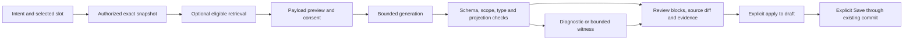

# AI-native development in Allow

Phased product specification, 5 November 2026. The normative requirements are in
[ai-native-development.json](../spec/ai-native-development.json). This is a proposed
extension to the existing workbench. The narrower
[private system integration](ai-system-integration.md) is now implemented;
the remaining phases below are still proposed and public AI stays disabled.
The [review and proof record](../gates/ai-native-v1/report.json) states the exact
contract hash, council decisions, finite model results and remaining obligations.

The product should help users turn an intention into a specification they can
inspect and test. The source editor and typed blocks stay central. AI assistance
works on the selected declaration, hole, diagnostic or counterexample, and offers
a concrete change with assumptions and evidence. Users retain explicit control
over applying a draft and saving an accepted revision.

## The development loop

Start with **Explain selection** and **Fill typed slot**. Follow with generation
from intent, diagnostic/counterexample repair, authorized pattern retrieval and
comparison of alternatives. These are contextual editor actions, rather than an
unrestricted chatbot with access to the server.

For example, a user selects a formula hole and asks for at least one `Node`.
An illustrative proposal is `some Node`. Allow shows its block and source diff,
checks that `Node` is in scope and the result is a formula, and lets the user
apply it as one undoable draft edit. The visible name stays `Node`; backend
structural representations use anonymous slots. This example is illustrative,
not a recorded solver result.

Partial proposals can fill a draft while preserving known slot constraints,
but remain visibly incomplete and cannot become accepted complete artifacts.
Valid source outside the supported block grammar remains `TEXT_ONLY`; the UI
must not invent a block representation. Explanations distinguish checked facts,
bounded solver results and model inference.

## Authority and exact edits

Spring remains responsible for workspace authorization, quotas and persistence.
An AI proposal binds the exact owner/session incarnation, document and accepted
revision, draft hash/epoch, selected occurrence and obligations, proposal bytes,
policy/dependency/model versions and any retrieved record versions. An edit to
the draft invalidates an old proposal rather than silently rebasing it.

Approval is a distinct explicit action. The server verifies current authority
and issues a bounded receipt for one local draft edit. React checks its live draft
atomically, applies the entire change as one undoable transaction and consumes
that identity. Save uses the existing durable validation, expected-revision and
idempotent commit path. AI generation never commits a document.

The network boundary matters: a server cannot instantly revoke content or a
receipt already delivered to a browser. A browser that has not observed a later
revocation may still apply that previously granted local draft edit before its
receipt expires. Known invalidation or staleness blocks application. Every later
server action and Save rechecks current authority and revision. The contract
states this limit explicitly instead of claiming atomic browser/server revocation.

No model receives a shell, arbitrary network fetch, SQL executor, filesystem,
deployment action or permission editor. Retrieved material and model responses
are untrusted data. Restricted functionality and permissions are enforced outside
the prompt, consistent with OWASP's description of excessive agency.
([OWASP](https://genai.owasp.org/llmrisk/llm062025-excessive-agency/))

## Retrieval and disclosure

Keep the existing vector representation and ranking unchanged:

- Anonymous environment/context and a checked bounded e-graph predicate form.
- Exactly N distinct positive and N distinct negative complete instances,
  with N between3 and5 and identical solver bounds.
- Four768-dimensional structural blocks forming the3072-dimensional embedding.
- The existing weighted hierarchy similarity and compatible positive/negative
  pool overlaps, with the components visible to the user.

Retrieval begins with an authorized admitted `recordId`. Freeform chat is not
automatically a compatible query vector. A new predicate must pass the existing
admission/pool pipeline first; incomplete or unsupported predicates get no
published retrieval vector. The current small dataset pilot is not evidence of
general semantic search quality.

Public anonymous workspaces retain **no private corpus access**. No visitor draft
or conversation becomes training or embedding data automatically. A future public
catalog needs separate publication and rights review.

All contributing records require an `ai_generate` purpose grant. Remote disclosure
additionally requires `ai_disclose`, including derived witnesses. Local retrieval
rights do not imply either. A user sees the exact prepared payload and provider
terms before authorizing disclosure. A changed payload or new dispatch attempt
requires fresh matching consent; an exact retry of a completed approval request
does not dispatch again.

Default payloads omit visual source names, comments, paths, provenance and
credentials, and include anonymous structure plus the reviewed intent. The intent
may itself contain identifying information. Structural anonymization preserves
semantics and does **not** guarantee confidentiality. Provider retention/training
terms remain an independent deployment gate.

## Integration and operating limits

Use closed modes: `OFF`, `LOCAL_ASSISTED`, `REMOTE_ASSISTED`. Default remains OFF.
Select one provider-neutral adapter after evaluating a pinned model, endpoint,
terms, latency and tariff. A local generative model is not assumed to fit alongside
Allow on the4vCPU/8GiB deployment host.

The initial bounds are one global provider call, two queued requests, one generation
job per workspace, at most two provider calls per job and three retained proposals.
Each call allows at most8192 input tokens,2048 output tokens,64KiB input and32KiB
output. The provider timeout is20seconds; the entire job expires after60seconds.
These are proposed limits, not measured performance claims.

Reserve the worst-case bill before dispatch, including outstanding requests and
all provider-billed token categories. Unknown tariff or unavailable budget storage
denies dispatch. Timeout or cancellation does not establish that a provider stopped
work or waived billing, so uncertain reservations remain charged conservatively.
No automatic provider fallback or uncertain-dispatch retry is permitted. Public
paid inference stays disabled until a global hard budget, abuse controls and an
operator kill switch pass acceptance.

Keep the current single solver/validator and SQL-context lanes. Do not hold either
across a provider request or a human review. Manual editing remains local and manual
server work takes priority over cancellable AI work. AI-off regression, provider
latency, validation latency and useful-result cost are measured separately; the
existing failed300ms server validation target is not waived.

LangGraph is an optional adapter to the fixed workflow, not a second authority
system. Its checkpoints store graph state, and interrupts permit pause/resume;
Allow must still recheck authorization and exact operation identity on resume.
([Persistence](https://docs.langchain.com/oss/python/langgraph/persistence),
[interrupts](https://docs.langchain.com/oss/python/langgraph/interrupts))
The retrieval adapter returns `Document` objects. The new private assistant adds
generation separately without corpus access or durable graph checkpoints.
Every PostgreSQL operation must pass
SQLeanParser; a stock PostgreSQL checkpointer cannot be enabled without a reviewed
compatible adapter. Initial anonymous prompt/proposal state is bounded, volatile
and invalidated on restart; minimal cost reservations survive restart without
storing model content or credentials.

## Delivery sequence and acceptance

1. **A0 — contract and model:** finish the six-seat review and two clean pinned
   Lean builds. Keep production AI disabled.
2. **A1 — private typed assistance:** implement Explain/Fill slot using a fake
   provider, closed DTO schemas, exact draft binding and explicit apply/save.
3. **A2 — private retrieval and repair:** connect admitted records and witness-linked
   repairs, preserving ranking, lineage, rights and public/private separation.
4. **A3 — opt-in real provider:** implement payload consent, bounded egress,
   conservative accounting and provider-fault recovery; benchmark the target.
5. **A4 — limited anonymous pilot:** retain corpus restrictions and require native
   deployment, expiry, abuse and hard-spend acceptance before enabling access.
6. **A5 — commercial candidate:** evaluate actual customer outcomes and economics;
   optionally add enterprise durable checkpoints under a separate adapter gate.

Freeze at least120 held-out tasks across30 distinct families before tuning:
80 edit tasks and40 explanation/witness tasks. Proposed quality gates are95%
first-attempt schema validity,80% independently judged edit correctness and90%
evidence-linked explanation factuality. Report denominators, abstentions and
confidence intervals. Deterministic oracles and independent Alloy reviewers judge
correctness; GPT-6 Luna can supply supplemental adversarial retrieval/judging
fixtures, never the sole correctness oracle.

The security matrix contains at least96 fixed cases covering injection, output
handling, scope substitution, replay, consent, revocation, budgets, unknown billing,
types/partial constraints, fabricated evidence and framework bypasses. Include
the post-approval revocation race and its documented local-draft behavior.
Zero violations in this finite matrix is a release requirement, not a universal
security guarantee. Native browser accessibility, concurrency, expiry, restart
and SQL-context cleanup need their own implementation evidence.

## Commercial decision

Educator assistance and professional specification review are customer hypotheses.
Use a consenting pilot with counterbalanced manual/assisted tasks to measure
completion, mistakes, time, support effort and purchase interest. Calculate cost
per useful accepted draft from actual provider charges, solver resources,
retrieval, storage, support and licensing obligations.

Do not treat possession of Alloy4Fun/Alloy5/Alloy6 files as permission to disclose,
redistribute or commercialize them. Provider/model terms, per-origin rights,
retention commitments and native deployment acceptance remain explicit gates.
Commercial release remains **NO_GO** until those gates have evidence.

The Lean supplement checks a finite policy abstraction. It assumes authentic
receipts and accurate authority, clock, type-validation and cost observations;
it does not prove generated Alloy, LLM quality, implementation refinement,
cryptography, distributed race freedom, provider billing or commercial viability.
Its [claim map](../gates/ai-native-v1/claim-map.md) makes that scope reviewable.
