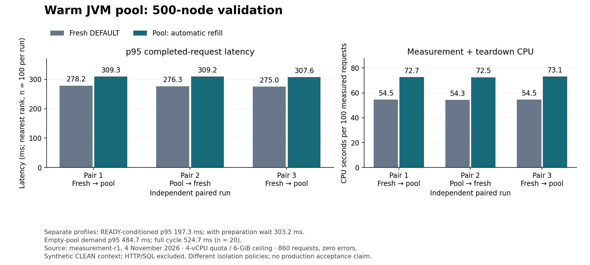

# Warm JVM component latency results

On 4 November 2026, the automatic-refill pool was **11.2–11.9% slower at p95**
than fresh DEFAULT workers for immediate back-to-back 500-node validation.
Pooling remains disabled. The [terminal report](../gates/performance/warm-pool-candidate/latency-diagnostic/runs/measurement-r1/report.json)
passed every registered measurement, output and cleanup check; PASS is not a
latency improvement or production-acceptance verdict.

## Measurements

Three independent pairs used orders fresh/pool, pool/fresh, fresh/pool. Each
variant retained 20 warmups followed by 100 measured requests; percentiles use
the nearest rank without interpolation. No samples were discarded or retried.

- Pair 1: fresh p50/p95/p99 **271.1/278.2/354.8 ms**; pool
  **290.0/309.3/313.4 ms**. Pool p95 increased **11.18%**.
- Pair 2: fresh **269.6/276.3/406.6 ms**; pool **289.3/309.2/314.7 ms**.
  Pool p95 increased **11.88%**.
- Pair 3: fresh **269.9/275.0/277.8 ms**; pool **290.9/307.6/319.5 ms**.
  Pool p95 increased **11.84%**.
- Measurement plus teardown CPU increased **33.23%, 33.51%, 33.96%** per pair.
  These are complete component-scope CPU counters, not worker-exclusive CPU.
- Every one of the **300** measured serial pool admissions observed a STARTING
  replacement; none found READY. This demonstrates the observed refill state,
  without isolating the causal contribution of each implementation cost.

The separate READY-conditioned profile had request p50/p95/p99
**187.2/197.3/199.9 ms**. Its excluded preparation-wait p95 was **112.9 ms**;
the measured full-cycle p95 including wait was **303.2 ms**. Percentiles are
computed independently and must not be added. Its serial completion rate,
including wait, was **3.47 requests/s**, not a sustained-capacity estimate.

For 20 independent empty-pool first demands, request p95 was **484.7 ms** and
full-cycle p95 was **524.7 ms**, including initialization and shutdown.
The largest whole-scope memory peak across the eight profiles was **508.0 MiB**.

All **860 attempts** passed: **140 warmups and 720 measured requests**. Full
responses matched the fresh oracle under the declared generated-ID bijection.
All eight scopes were positively empty, their launchers reaped and identities
absent, with unchanged frozen inputs and removed units. The preceding exact-input
eleven-case ownership probe and two-scope fixture preflight also passed.

## Scope and reproducibility

The [contract](../gates/performance/warm-pool-candidate/latency-diagnostic/contract.json)
was reviewed by two GPT-6.1 Terra, two GPT-6.1 Sol and two GPT-6 Astra agents.
The [corrected Lean supplement](../gates/performance/warm-pool-candidate/latency-diagnostic/policy-proof-report-r2.json)
checks 14 finite policy propositions in two matching clean builds. These preceded
the gate code. The proof does not verify clocks, Java/OS refinement or measured
performance; the earlier proof-model defect and its repair remain recorded.

The actual `DocumentWorker(DEFAULT)` and `WarmWorkerPool` run in separate copied
installations, with four CPU quota, affinity 0–3, a 5-GiB peak objective, 6-GiB
ceiling, no swap and 512-task limit. Workers remain single-use. The supervisor
retains bounded response buffers and uses the same 1-GiB heap cap in all profiles.
Fresh workers occupy the outer control leaf; pool workers use owned child groups.
This compares the implemented component policies, not JVM prewarming alone.

The context is **TEST_ASSUMED_CLEAN_CONTEXT_NO_SQL**. There is no HTTP request,
SQL/history resolution, selected Spring `WarmRuntime` path, concurrent open-loop
load or actual slower production host. Workstation quotas screen the chosen
**4 vCPU / 8 GiB** baseline; they do not emulate its hardware. These results
must not be compared directly with earlier HTTP latency values or presented as
the strict three-pair, 1,000-request HTTP acceptance gate. Real context work may
overlap refill differently; that remains unmeasured.

The [derived summary](../gates/performance/warm-pool-candidate/latency-diagnostic/runs/measurement-r1/analysis/summary.json)
binds terminal report SHA-256
`6b99006357f9da6b316b8246d9ea87431b7fc26864b041e8e037bfba91b7b57c`.
The [CSV](../gates/performance/warm-pool-candidate/latency-diagnostic/runs/measurement-r1/analysis/samples.csv)
retains all 860 durations, warmup labels, cycle durations, preparation waits and
admission phases. The [analysis script](../gates/performance/warm-pool-candidate/latency-diagnostic/analyze_metrics.py)
independently recomputes request ranks from raw rows before exporting. Full raw
outputs, counters and registrations remain linked from the terminal report.

No production executable changed in this diagnostic, no live preview was
restarted and no profile was activated. Full safety, semantic, SQL, HTTP,
soak, target-host and commercial gates retain their recorded open status in
the [implementation index](../gates/performance/warm-pool-candidate/implementation/status.json).
